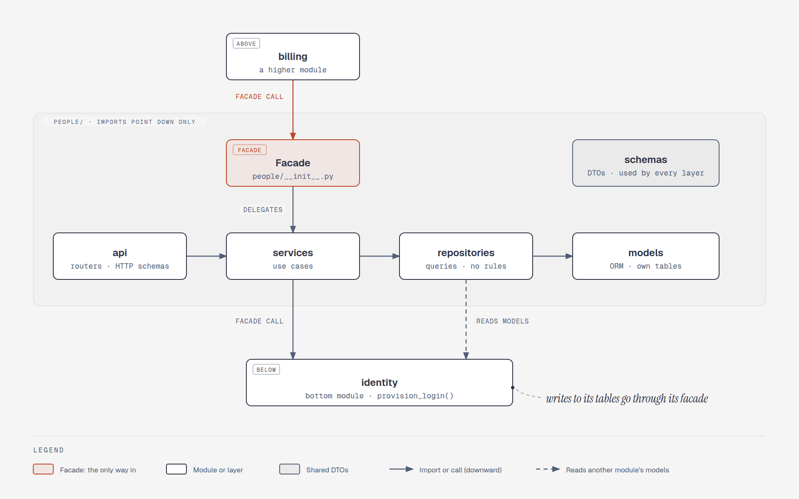
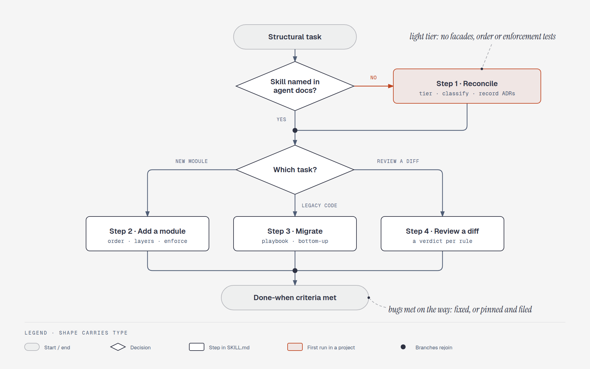
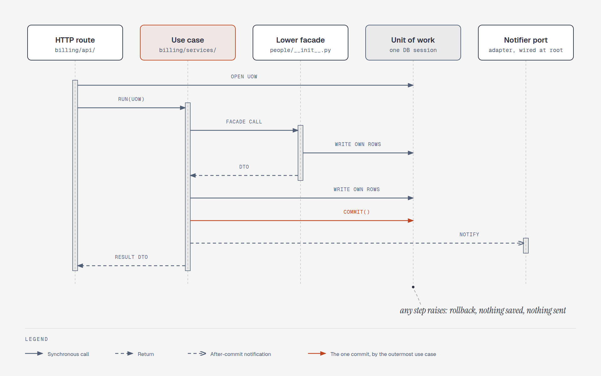
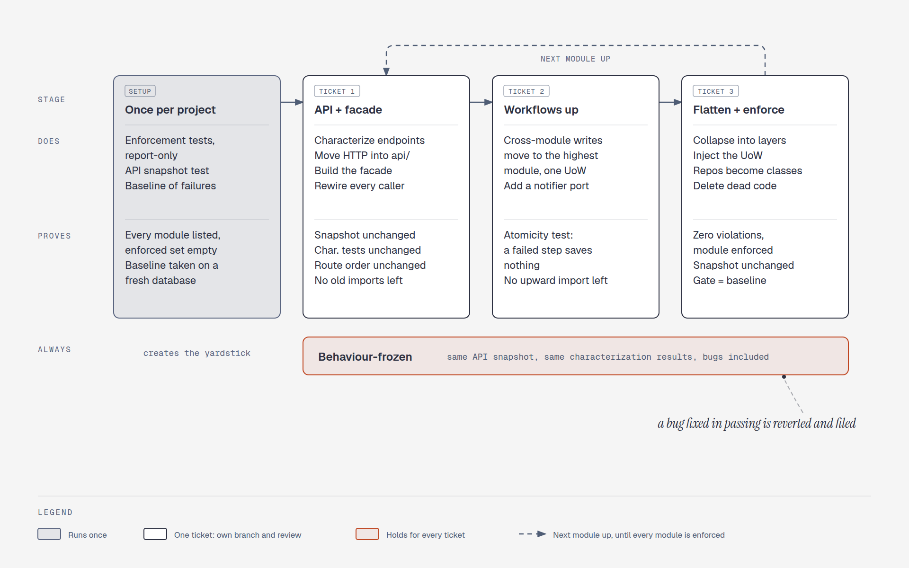

# modular-architecture

An agent skill (Claude Code, OpenCode, and any agent that reads `SKILL.md` folders) for building and migrating backends as a **modular monolith**: layered modules behind facades, a fixed module order, one unit of work per use case.

- **Default decisions** with reasons and rejected alternatives: [references/decisions.md](references/decisions.md)
- **Reconciles with each project:** the project's own ADRs win, disagreements are raised once, missing decisions are proposed and recorded ([references/reconcile.md](references/reconcile.md))
- **Migration playbook:** legacy modules move one at a time, behaviour-frozen, each ticket with proof criteria ([references/playbook.md](references/playbook.md))
- **Python/FastAPI notes** and ready-to-copy enforcement tests (import-graph rules, OpenAPI snapshot): [references/python-fastapi.md](references/python-fastapi.md), [templates/python/](templates/python/)
- **Optional diagrams**, offered and drawn only on request: [references/diagrams.md](references/diagrams.md)

The agent entry point is [SKILL.md](SKILL.md).

## Diagrams

Sources are the HTML files in [docs/diagrams/](docs/diagrams/), generated by `build.py`; the PNGs come from `export_png.py`.

### One module, behind its facade



### Which branch the skill takes



### A cross-module write in one unit of work



### Migrating a module, ticket by ticket



## Install

```sh
git clone https://github.com/ibrhmahmd/modular-architecture ~/Desktop/modular-architecture
for dir in ~/.agents/skills ~/.claude/skills; do
  mkdir -p "$dir"
  ln -sfn ~/Desktop/modular-architecture "$dir/modular-architecture"
done
```

OpenCode reads both `~/.agents/skills` and `~/.claude/skills`, so these two links cover Claude Code and OpenCode.
